 

 

## `$ cat stack.json`

**`systems & desktop`**

**`frontend`**

**`backend`**

**`data & infra`**

**`tooling`**

## `$ git log --stat`

## `$ ./contributions --graph`

<picture>
  <source media="(prefers-color-scheme: dark)" srcset="https://raw.githubusercontent.com/SDcold/SDcold/output/snake-dark.svg">
  <source media="(prefers-color-scheme: light)" srcset="https://raw.githubusercontent.com/SDcold/SDcold/output/snake.svg">
  
</picture>

## `$ curl -X POST /connect`

 

